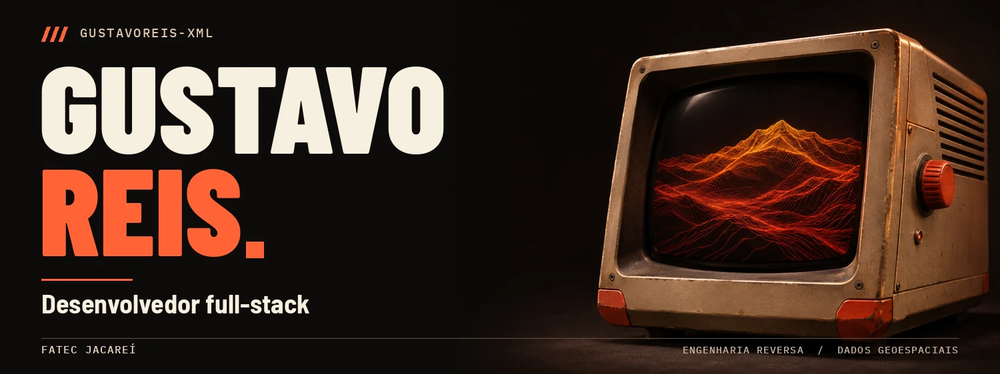
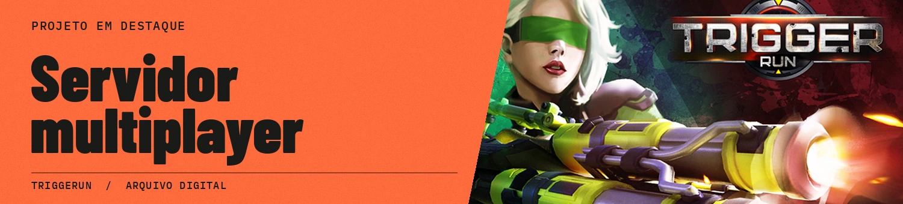
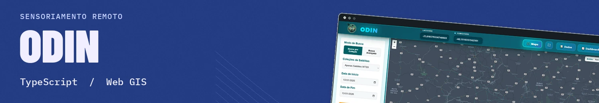
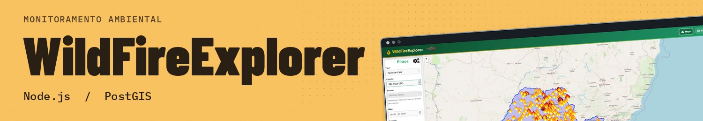
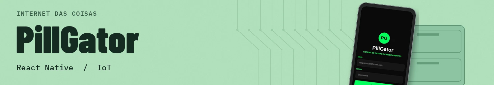
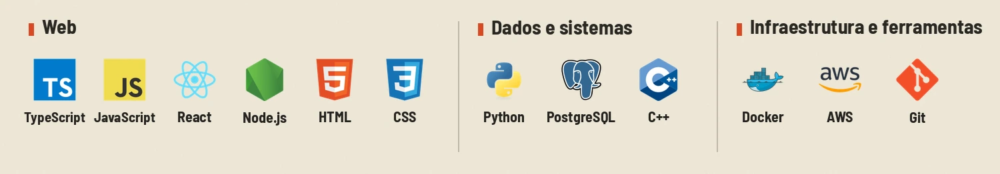

<h1>
<picture>
  <source media="(max-width: 600px) and (prefers-reduced-motion: reduce)" srcset="assets/perfil/capa-mobile.webp" />
  <source media="(max-width: 600px)" srcset="assets/perfil/capa-mobile-crt.webp" />
  <source media="(prefers-reduced-motion: reduce)" srcset="assets/perfil/capa.webp" />
  
</picture>
</h1>

Estudo Desenvolvimento de Software Multiplataforma na **Fatec Jacareí**. Gosto de investigar como os sistemas funcionam, seja comparando imagens de satélite ou descobrindo como um jogo conversa com o servidor.

  
  

<h2>
<a href="https://gustavoreis-xml.github.io/Triggerun-O-Arquivo-Digital/">
<picture>
  <source media="(max-width: 600px)" srcset="assets/perfil/triggerun-mobile.webp" />
  
</picture>
</a>
</h2>

Quero voltar a jogar **Triggerun** em multiplayer. Para isso, estudo o protocolo de rede do jogo e estou reconstruindo seu servidor em **Node.js**. No **Arquivo Digital**, já dá para explorar os 23 heróis recuperados, suas habilidades e seus cosméticos. Mais adiante, quero reunir o servidor e o acervo.

  

## Projetos acadêmicos com a CodeGators

<a href="https://github.com/CodeGators/ODIN-Documenta-o">
<picture>
  <source media="(max-width: 600px)" srcset="assets/perfil/odin-mobile.webp" />
  
</picture>
</a>

Escolha um ponto no mapa e compare séries de diferentes satélites, como o índice de vegetação NDVI.

<a href="https://github.com/CodeGators/WildFireExplorer---Front-Server">
<picture>
  <source media="(max-width: 600px)" srcset="assets/perfil/wild-mobile.webp" />
  
</picture>
</a>

Explore focos de calor, áreas queimadas e risco de incêndio no Brasil com os dados do Programa Queimadas do INPE.

<a href="https://github.com/CodeGators/PillGator-ABP4_DSM">
<picture>
  <source media="(max-width: 600px)" srcset="assets/perfil/pill-mobile.webp" />
  
</picture>
</a>

Uma gaveta libera o medicamento no horário programado. O aplicativo avisa o cuidador se a retirada atrasar.

## Tecnologias

<picture>
  <source media="(max-width: 600px)" srcset="assets/perfil/tecnologias-mobile.webp" />
  
</picture>

## Atividade no GitHub

Ver estatísticas e linguagens dos repositórios públicos

  
  

<!-- Arte promocional de Triggerun: 2Axion, distribuída na página do jogo no Steam (app 897290). Capturas de ODIN, WildFireExplorer e PillGator: portfólio de Gustavo Reis na Fatec Jacareí. Ícones de tecnologia: Devicon (MIT). -->

<!-- Devicon · https://github.com/devicons/devicon/blob/v2.17.0/LICENSE
The MIT License (MIT)

Copyright (c) 2015 konpa

Permission is hereby granted, free of charge, to any person obtaining a copy of
this software and associated documentation files (the "Software"), to deal in
the Software without restriction, including without limitation the rights to
use, copy, modify, merge, publish, distribute, sublicense, and/or sell copies of
the Software, and to permit persons to whom the Software is furnished to do so,
subject to the following conditions:

The above copyright notice and this permission notice shall be included in all
copies or substantial portions of the Software.

THE SOFTWARE IS PROVIDED "AS IS", WITHOUT WARRANTY OF ANY KIND, EXPRESS OR
IMPLIED, INCLUDING BUT NOT LIMITED TO THE WARRANTIES OF MERCHANTABILITY, FITNESS
FOR A PARTICULAR PURPOSE AND NONINFRINGEMENT. IN NO EVENT SHALL THE AUTHORS OR
COPYRIGHT HOLDERS BE LIABLE FOR ANY CLAIM, DAMAGES OR OTHER LIABILITY, WHETHER
IN AN ACTION OF CONTRACT, TORT OR OTHERWISE, ARISING FROM, OUT OF OR IN
CONNECTION WITH THE SOFTWARE OR THE USE OR OTHER DEALINGS IN THE SOFTWARE.
-->
